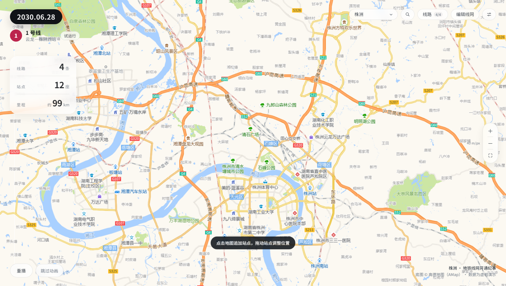

# 城市地铁线网开通纪事 · Metro Chronicle

极简、克制的**单文件**地铁线网开通动画纪事：以虚构的「株洲市地铁」为默认场景，**按开通日期先后**逐条播放线路开通与单站启用；镜头会像特写一样跟住正在延伸的线路，事件之间拉远平移再推近，最后收束成全网全览。支持多线路（地铁 + 城际铁路）、城市切换、地图点选编辑线网、高德底图，并附带一个**零依赖 Node 后端**用于方案的服务端存储。

- 交付物：`地铁线网开通纪事.html`（约 435 KB，**双击即开**，内联 Leaflet 1.9.4 + GSAP 3.12.5，无需构建、无需联网即可播放）
- 自测：**573 项自动化断言全部通过**，见 [docs/自测结果.md](docs/自测结果.md)



## 快速开始

### 方式 A：双击打开（离线可用）

直接双击 `地铁线网开通纪事.html`。

底图按「高德（内置 Key）→ OpenFreeMap Positron 矢量 → Esri 灰度栅格 → 本地浅灰画布」逐级降级；断网时零请求、零控制台报错，动画照常播完。方案保存在浏览器 `localStorage`（按城市隔离）。

### 方式 B：前后端一体（方案存服务端）

```bash
node server/server.mjs          # 默认 http://127.0.0.1:8787 ；可用 PORT 指定端口
```

打开 <http://127.0.0.1:8787/> ：启动即从 `/api/plans` 拉取方案，编辑后写穿到服务端（`server/data/store.json`），换浏览器/设备也能拿到同一份方案；服务端不可达会自动退回纯本地模式且不报错。

API 与数据格式见 [server/README.md](server/README.md)。

## 功能一览

| 模块 | 说明 |
| --- | --- |
| 镜头叙事 | **统一节奏**：所有线路都用**同一个特写比例 A**（= 全景缩放 + 2.2，夹在 12.5–16）——拉进镜头到 A → 镜头跟着延伸头部沿线展示（比例恒定）→ 画完**拉回原全景比例**展示整条线路 → 下一条线再把镜头移到它的起点、重新缩放至 A；全部结束后收束为全网全景。**跨层缩放用一次 Leaflet 动画直达**，整段约 2 分钟 |`n| 高帧率渲染 | 平移走 `_rawPanBy`（只改一个 transform，瓦片/站点/线路随画布一起移动，不重投影、不重建 SVG）；**正在延伸的线路用 canvas 逐帧描已揭示段**（成本 ∝ 已画长度），画完再一次性交给 SVG；沿线预取瓦片、瓦片网格重算按位移攒批触发 | 自测 t19：自绘 JS 开销 **< 1ms/帧**（camera 0.05ms + canvas 0.04ms + scene 0.11ms），平移中 setView 次数「事件级」而 panBy 每帧一次 |
| 时间顺序 | 所有开通动作展开成事件并按**开通日期**升序播放：整条线路开通、单个站点启用会自然穿插（例：3 号线 2034.03 → 荷塘单站 2035.06 → 城际 2035.09） |
| 单站开通 | 站点可设为「单独开通」并填写自己的开通日期：动画只飞向该点、只点亮这一个点，顶栏切为「站点开通」 |
| 多线路 | 默认株洲 4 条（1/2/3 号线 + 长株潭城际），右上「线路」面板可多选参与播放的线路 |
| 城际铁路 | 虚线描边 + 圆角「城际」徽章 + 站名「城际」胶囊；仅城际服务的站用方形站标 |
| 线网示意图 | 顶栏「示意图」按钮可**运行中切换**地理视图 ↔ 示意图（无需刷新）；布局由 WGS84 数据**自动派生八方向**（45°/90° 折角、换乘站单点、标签 16px 且零重叠），**段长按真实距离成比例、走向保真度 84.8%（平均方位偏差 3.9°）**；时间轴直接复用 Story.buildEvents() 与 STORY_TIMING；编辑或切换城市后自动重排 |
| 视频导出 | 「导出视频」按钮按视图分流：**示意图视图用逐帧确定性渲染**（时间轴暂停后精确 seek，每帧严格对应 t=i/fps，可 1080p/4K，样例 docs/samples/株洲地铁开通纪事_示意图_1080p.mp4：1920×1080 / 18s / 540 帧 / 3.1MB）；地理视图仍用实时录制（docs/samples/株洲地铁开通纪事_20s.mp4）。两者都由浏览器直接产出 MP4（H.264），无需 FFmpeg |
| 离线底图 | 
ode tools/build-pmtiles.mjs 把城市范围瓦片打成 **PMTiles 单文件**（当前 100 张 / 0.53MB，z9–13）；
ode build.mjs 地铁线网开通纪事_离线版.html --offline 把底图 base64 内联进 HTML，**断网也能完整播放** |
| 底图缓存 | 瓦片经 IndexedDB 缓存（TileCache）：首次加载写入本地，之后刷新/重开直接命中，不再每次重新下载；无 IndexedDB 时自动退化为内存缓存 |
| 换乘站 | **单点 + 多色圆环，颜色随开通线路数渐进**：只有一条线开通时保持单色；第二条接入才变两色；第三条接入才变三色（不会提前变成最终配色）。「暂未开通」站被后续线路经过时做一次收束弹开的强调 |
| 地图源 | 高德（GCJ-02 投影，编辑与存档仍为 WGS84）/ OpenFreeMap 矢量 / Esri 栅格，三级静默降级 |
| 缩放 | 右侧常驻 ＋ / － / 复位视野 / 比例尺；**播放动画期间按钮置灰禁用、滚轮一律不缩放**（比例完全由镜头控制），播放结束/编辑态才可手动调整 |
| 编辑 | 地图点选加站、45m 同线选中、90m 跨线吸附为换乘站、拖动改坐标、站名/暂未开通/**开通方式与日期**、前移后移、删除、清空本线、恢复默认、**线路设置**（名称/徽章/类型/开通日期/配色/删除）、完成并播放 |
| 城市 | 内置株洲、湘潭；**城市搜索**接入高德行政区查询（可搜到省级/地级市/县级市/区县/街道，选中即按其中心建城并做 GCJ→WGS 转换），高德不可用时退化为本地城市名过滤；支持自定义城市（空白线网从零编排）；按城市隔离存储 |
| 统计 | 线路数 / 站点数 / 里程全部实时计算（站点按去重计，里程为平滑曲线 Haversine 累加后取整，只累加已开通线路） |

## 目录结构

```
.
├─ 地铁线网开通纪事.html     # 交付物：内联依赖的单文件应用（由 build.mjs 生成）
├─ build.mjs                 # 构建：把 vendor + src 合成单个 HTML
├─ src/                      # 应用源码（按 00~80 分段，中文注释）
│  ├─ 00-util.js             # 通用工具（转义 / 存储 / 提示）
│  ├─ 10-cities.js           # 数据层：线路类型 / 城市预设 / plan 规范化、日期解析、持久化
│  ├─ 15-remote.js           # 可选后端同步（本地优先 + 写穿）
│  ├─ 20-basemap.js          # 地图源：高德 / 矢量 / 栅格 三级降级 + GCJ-02 投影
│  ├─ 30-geometry.js         # Haversine、向心 Catmull-Rom、标签方位、坐标转换
│  ├─ 40-scene.js            # 场景：三层描边、站点标记（多色换乘环）、头部标记、标签避让
│  ├─ 45-camera.js           # 镜头：按跨度反推 zoom、跟拍、弧线飞行、全览适配
│  ├─ 50-story.js            # 时间轴：按日期排序的事件表 + 镜头编排
│  ├─ 60-edit.js             # 编辑模式（含线路设置面板、站点开通方式）
│  ├─ 70-city.js             # 城市切换 / 线路多选 / 缩放控件 / 地图设置
│  ├─ 80-boot.js             # 启动装配与调试接口
│  ├─ app.css                # 样式（极简浅灰、低饱和）
│  └─ shell.html             # HTML 骨架（占位符由 build.mjs 注入）
├─ vendor/                   # 内联依赖：Leaflet 1.9.4、GSAP 3.12.5（含许可证）
├─ server/                   # 零依赖 Node 后端（静态服务 + 方案 API）
├─ tools/                    # 构建/测试工具
│  ├─ probe.mjs              # 无依赖 CDP 探针（真实 Chrome 渲染 + 控制台/异常采集）
│  ├─ run.mjs                # 测试运行器（可读报告）
│  ├─ tune.mjs               # 里程标定脚本
│  └─ tests/*.js             # 27 套断言脚本
└─ docs/                     # 截图与自测报告
```

## 构建与自测

```bash
node build.mjs                 # 生成 ./地铁线网开通纪事.html
node tools/run.mjs --wait=30000 --eval=tools/tests/t1-baseline.js
node tools/run.mjs --wait=2000  --eval=tools/tests/t14-camera.js    # 镜头：固定缩放 / 单站特写 / 全览
node tools/run.mjs --wait=2000  --eval=tools/tests/t15-progressive.js  # 换乘配色渐进（2 色 → 3 色）
node tools/run.mjs --wait=2000  --eval=tools/tests/t17-flicker.js      # 播放全程无空白帧
node tools/run.mjs --wait=2000  --eval=tools/tests/t18-framing.js      # 每线取景装得下整线
node tools/run.mjs --wait=2000  --eval=tools/tests/t19-fps.js          # 帧率/渲染管线
node tools/run.mjs --wait=2000  --eval=tools/tests/t20-canvas-align.js  # 线路与站点像素对齐
```

测试基于真实 Chrome（CDP 驱动，无 npm 依赖），支持 `--offline`（断网模拟）、`--mobile`（390×844）、`--page=http://…`（前后端）、`--eval=__RELOAD__`（页面重载后校验持久化）。完整命令清单见 [docs/自测结果.md](docs/自测结果.md)。

## 依赖与许可

- [Leaflet 1.9.4](https://leafletjs.com/) — BSD-2-Clause，已内联（`vendor/leaflet.LICENSE.txt`）
- [GSAP 3.12.5](https://gsap.com/) — GreenSock 标准授权，已内联；如需商用请自行确认其授权条款
- 底图：高德地图 / [OpenFreeMap](https://openfreemap.org/) Positron / Esri World Light Gray — 版权归各自提供方，遵循其使用条款
- 本项目代码不含任何 npm 依赖，也不需要构建工具链（`build.mjs` 只用 Node 内置模块）

## 已知限制

1. **高德 Key 按需求内置在 `src/10-cities.js`**（`AMAP_KEY`）。仓库公开意味着该 Key 公开；如不希望泄露，建议改为运行时输入或替换为受限 Key（页面内「地图设置」可覆盖/清除，代码会优先使用本地保存值）。
2. **镜头缩放会带来少量瓦片请求**：高德栅格瓦片按整数层级取图，换级时会重取该层瓦片。已关闭 Leaflet 自身的缩放/瓦片淡入动画、并让缩放只在整数层级切换，实测一次完整播放约 **10–40 次** `net::ERR_ABORTED`（中止的图片请求，不产生 console 报错）；断网/栅格兜底场景无此问题。
3. 城际铁路走向、开通日期均为**虚构演示数据**；站名与经纬度取自株洲/湘潭真实地点。
4. 无 Key 或 Key 无效时的矢量底图（MapLibre）在跨城市大跨度跳转时，会打印 1 条第三方样式解析 warning（非 error）；高德与栅格底图无告警。
5. 窄屏（≤720px）站点过密时会隐藏次要站名（终端站/换乘站始终保留），放大或复位视野后恢复。
6. 后端无鉴权、无 TLS，默认仅监听 `127.0.0.1`，单实例文件存储（后写者胜），适合本机/内网演示。
